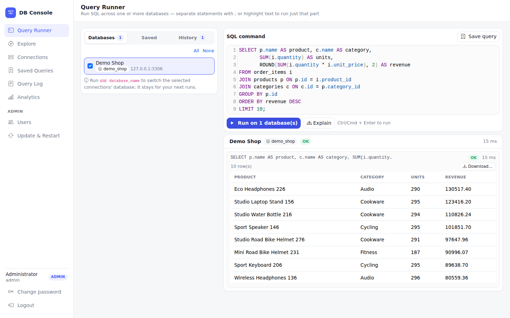
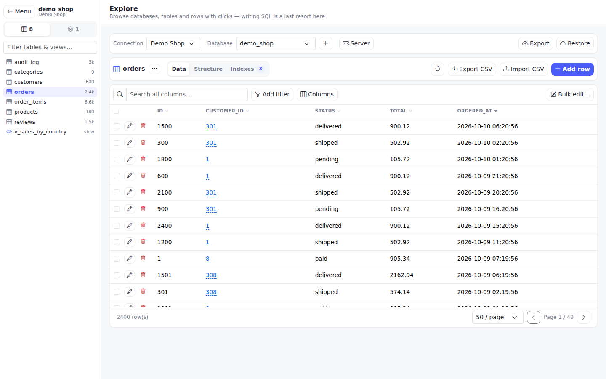
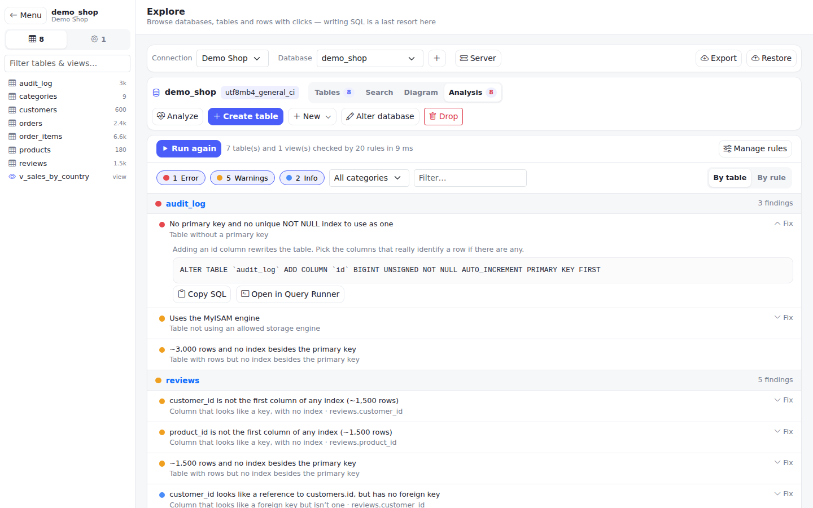
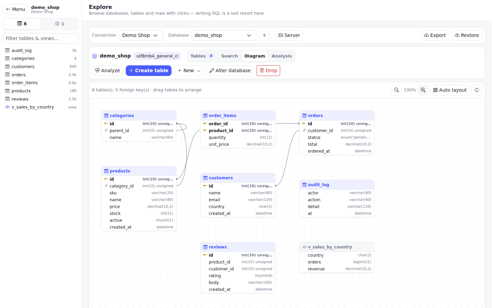
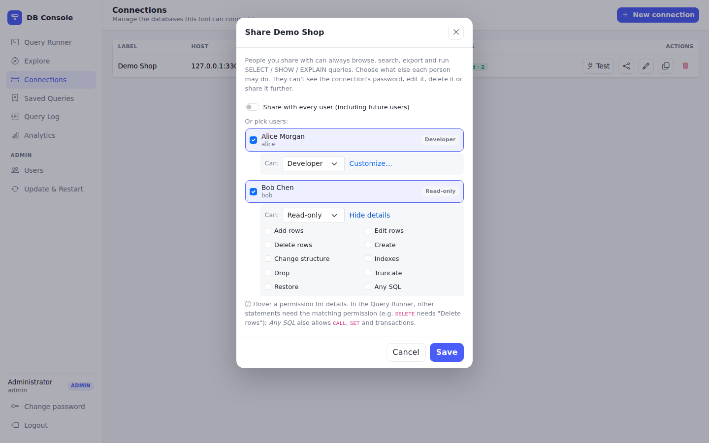

# DB Console

**Your databases in a browser. One small app, nothing else to install.**

Browse tables, edit data, run SQL across several databases at once, find what is slow or broken, back everything up, and give your team exactly the access they need — all from a single Node.js app that starts in seconds and keeps its own settings in plain files. No extra database, no heavyweight stack.



## Why people use it

* **Drop it anywhere.** Put it on a client's server, next to an application, or on a laptop. `npm install`, `node server.js`, done — or one `docker compose up`.
* **Made for the real job.** Support, operations and developers who need to *look at* a database, fix a row, run a query, check health or take a backup — without learning a big admin platform.
* **Safe to hand to a team.** Share a connection with one person or everyone, choose what they may do, hide databases and tables, and ask for approval before anything dangerous runs.
* **Three databases, one interface.** MySQL / MariaDB, PostgreSQL and SQLite.

## What you get

| | |
|---|---|
| 🗄️ **Explore** | Click through databases, tables, views and routines. Sort, filter, search and edit rows in place. Structure, indexes, foreign keys and a draggable schema diagram. Import CSV, Excel and JSON. |
| ⚡ **Query Runner** | Run SQL on one or many connections at once. Highlighting, autocomplete, parameters, formatter, history, result tabs and charts, one-click Stop, and downloads as CSV, TSV or SQL. |
| ✨ **Managed Queries** | A library of ready-made queries for what is running right now, what is big, what is missing a primary key, unused indexes, blocking locks and more — for each database type. Admins add their own. |
| 🩺 **Analysis** | Finds missing indexes, risky settings and anomalies, writes the SQL to fix them, and applies a whole batch in one go. Check every database on a server together. |
| 🔁 **Compare & migrate** | See what differs between two databases, with a migration script. Compare the data row by row. |
| 📈 **Server health** | Connections, slow queries, open transactions, lock waits and trends, plus processes, variables and accounts. |
| 💾 **Backup & restore** | Streamed exports and restores of any size. Schedule backups, keep the last N, upload to S3 or SFTP, and test that the restore works. |
| ⏰ **Schedules & alerts** | Run queries, analyses, backups and connection checks on a timetable. Get told by email or webhook when something is wrong. |
| 👥 **Sharing & control** | Per-user permissions, database and table limits, read-only shares, approvals for risky statements, sign-in and query logs, notes on tables and queries. |
| 🔐 **Sign-in** | Local users, two-factor authentication, single sign-on (OpenID Connect), IP allow-list, session limits. |

Plus: dark mode, keyboard shortcuts, a phone-friendly layout, TLS and SSH tunnels to your databases, and connection passwords encrypted at rest.

## Screenshots

| | |
|---|---|
| <br>**Explore** — browse, filter and edit with clicks | <br>**Analysis** — problems found, with the SQL to fix them |
| <br>**Diagram** — tables and their foreign keys | <br>**Sharing** — each person gets exactly what they need |

## Start in a minute

```bash
git clone https://github.com/bismay4u/db-console.git
cd db-console
npm install
cp config_sample.js config.js      # optional: set your first admin and a session secret
node server.js                     # open http://localhost:3000
```

Sign in with the admin from `config.js` (the sample uses `admin` / `admin123!` — **change it right away**), add a connection, and go.

With Docker:

```bash
export SESSION_SECRET=$(openssl rand -hex 32)
export DBC_ENCRYPTION_KEY='a long passphrase you keep safe'
docker compose up -d               # http://localhost:3000
```

Needs Node.js 20 or newer. It also runs under PM2 and behind a reverse proxy, including in a sub-folder like `https://example.com/tools/db/`.

## Built to stay small

One Node.js process, a handful of dependencies, and its own data (connections, users, saved queries, logs) in simple JSON files you can back up by copying a folder. Large exports and restores stream, so memory stays flat.

## Learn more

The [**developer and administrator guide**](docs/developer.md) covers every feature in detail, configuration, Docker and PM2, running behind a proxy or in a sub-folder, single sign-on, the security model, the API, the test suite and the code layout.

## License

MIT — see [LICENSE](LICENSE).
